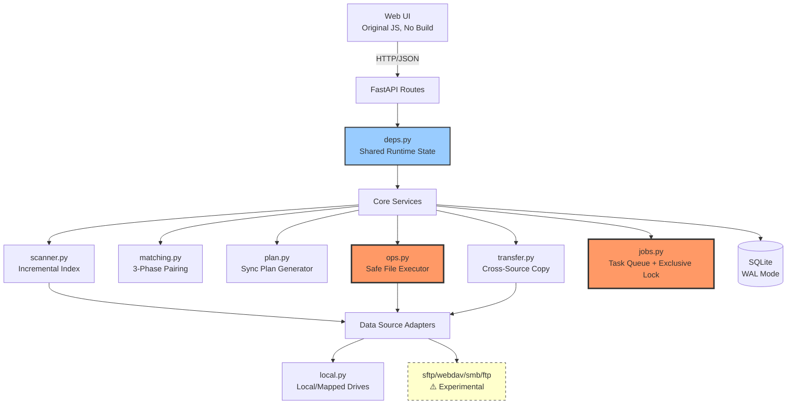

# Music Sync Hub - AI Context (Root Level)

> **Last Updated:** 2026-10-19 08:20:17  
> **Generated by:** init-architect workflow  
> **Project Status:** Personal production tool, actively maintained

使用简体中文

---

## Quick Navigation

- 📚 **[Module Index](#module-index)** — Detailed module-level CLAUDE.md files
- 🎯 **[Critical Constraints](#critical-constraints)** — 13 hard rules that prevent file loss
- 🗺️ **[Architecture Overview](#architecture-overview)** — System structure at a glance
- 🚀 **[Quick Start](#quick-start)** — Get oriented in 60 seconds
- 📖 **[Documentation Tree](#documentation-tree)** — All project docs

---

## What This Project Does

**Music Sync Hub** is a Windows music library manager that safely synchronizes music collections across multiple servers/locations where metadata differs but files are conceptually the same.

**Core Problem Solved:** Two music libraries (e.g., Windows + Linux) contain the same songs with different naming conventions, tags, or encodings. Traditional sync tools (rsync, robocopy) either blindly overwrite or fail to match files. This tool:

1. **Matches files intelligently** — Uses normalized filenames, duration, content hash, NOT just metadata
2. **Shows differences side-by-side** — Left/right comparison with confidence scores
3. **Finds duplicates** — Within or across libraries, by content hash
4. **Never overwrites by default** — All destructive actions require explicit confirmation
5. **Soft-deletes to trash** — Recoverable `.music-sync-trash/` directories

**Scale:** ~32,000 lines application code, ~11,000 lines tests, 94 HTTP endpoints, 723 unit tests, 90 API smoke tests.

**User:** Single-person tool. "Good enough" prioritized over "generic", but **file safety is non-negotiable**.

---

## Critical Constraints

These 13 rules are backed by real incidents (see `SAFETY.md`). **Read before any code changes:**

### 1. Single Source of Truth for Audio Extensions
```python
from app.core.paths import AUDIO_EXTS, is_audio  # Only source
```
- Frontend gets extensions from `/api/system` response
- Tests guard against duplicates: `tests/test_non_audio.py::AudioExtSingleSourceTest`
- Currently 22 formats: `mp3 flac m4a aac alac ogg oga opus wav aiff aif ape wv wma dsf dff mp4 m4b mpc tta mka caf`

### 2. Path Coordinates Must Be Relative
- **Rule:** Any cross-function path identifier = source-relative path (`d/x.mp3`)
- Only convert to absolute path at the moment of actual file I/O
- **Why:** `_reserve_targets` uses relative paths as keys; absolute paths cause key mismatches → silent file loss
- Guard: `tests/test_transfer.py::TargetConflictTest`

### 3. Exclusive Lock for Write Operations
```python
# app/core/jobs.py
EXCLUSIVE_KINDS = {"cleanup", "collect", "move", "organize", "scan", "station",
                   "sync", "tags", "transfer", "trash", "upload", "upload-commit"}
```
- New write operations MUST: Add kind to `EXCLUSIVE_KINDS`, create with `exclusive=True`, use `depends(exclusive_guard)` in HTTP layer
- Missing lock = two flows modify same files simultaneously

### 4. Never Unconditional `transform` Transitions in CSS
```css
/* ✗ WRONG - animates ANY transform change including layout shifts */
.btn { transition: transform .12s; }

/* ✓ CORRECT - only active state has transition */
.btn:active { transition: transform .12s; transform: translateY(1px); }
```
- Guard: `tests/test_organize_album.py::test_no_unconditional_transform_transition`

### 5. No Hardcoded Absolute Paths
```python
ROOT = Path(__file__).resolve().parent.parent  # ✓
ROOT = Path(r"C:\Users\...\MusicSyncHub")      # ✗
```

### 6. Bump `?v=NN` After Frontend Changes
- All static resources in `app/web/index.html` have version query strings
- Change any `.js`/`.css` → increment version number

### 7. Three Non-Negotiable File Safety Rules
1. **Never overwrite** — Default `policy=skip`, user chooses rename/overwrite
2. **Never truly delete** — Move to `.music-sync-trash/YYYYMMDD/` unless `hard=True`
3. **Copy-verify-delete for transfers** — `app/core/transfer.py::transfer_one`

### 8. `version_tags()` Field Set Must Match `dup_key`
```python
P.version_tags(name, title, rel_path)  # ✓ All three required
P.version_tags(name, title)             # ✗ Causes duplicate grouping errors
```
- Version markers can be in directory names (e.g., `Album (Remix)/Song.mp3`)
- Guard: Docstring in `matching.version_mismatch()` explains the incident

### 9. Tests Must Not Touch Real Data
- `tests/__init__.py` redirects `MSH_DATA_DIR` to temp
- Individual tests needing config/DB must create their own `TemporaryDirectory()`

### 10. All Destructive Operations Need `_guard_inside`
```python
from app.core.paths import inside_root  # Only validation logic
```
- Delete, trash, rename, copy, transfer, station operations MUST validate path is inside source root
- `paths.inside_root()` handles `..` traversal and Windows case-insensitivity

### 11. "Choose Name + Register" Must Be Atomic
- `Executor._claim_target` must check "not on disk" AND "not in `_planned`" in same lock
- Race condition caused 39/40 runs to silently lose files

### 12. Every Setting Must Be Wired
- Add `Settings` field → consumer code must reference it
- Guard: `tests/test_settings_wiring.py` checks every field is used outside `config.py`

### 13. Error Semantics Must Be Accurate
| Situation | HTTP | Exception |
|-----------|------|-----------|
| Source not found | 404 | `SourceNotFound` |
| Source is read-only | 403 | `ReadOnlyError` |
| Exclusive lock held | 409 | `JobBusy` |
| Invalid parameters | 400 | `SourceError` / `ValueError` |
| Uncaught errors | 500 | `Exception` (logged with stack) |

---

## Architecture Overview



### Key Design Decisions

1. **Single-file executor** (`ops.py`) — All file mutations go through one place
2. **Thread-local DB connections** — FastAPI pool + scan pool, WAL mode for concurrency
3. **Relative paths everywhere** — Absolute only at I/O boundary
4. **Default dry-run** — `execute=False` unless explicitly confirmed
5. **No build toolchain** — 18 sequential `<script>` tags, version string cache busting

---

## Module Index

### Backend Core (High Risk)

| Module | Lines | Risk | Purpose |
|--------|-------|------|---------|
| **[app/core/ops.py](app/core/ops.md)** | ~1200 | 🔴 Critical | Sole file executor. Change = full test suite required |
| **[app/core/transfer.py](app/core/transfer.md)** | ~400 | 🔴 High | Cross-source copy-verify-delete + heartbeat |
| **[app/core/matching.py](app/core/matching.md)** | ~800 | 🟠 Medium-High | Pairing algorithm, score thresholds, veto rules |
| **[app/core/plan.py](app/core/plan.md)** | ~500 | 🟠 Medium-High | Plan generation, mirror-delete, conflict resolution |
| **[app/core/jobs.py](app/core/jobs.md)** | ~350 | 🔴 High | Task state, exclusive lock, heartbeat reclaim, crash recovery |
| [app/core/scanner.py](app/core/scanner.md) | ~450 | 🟠 Medium | Scan-to-index, hash strategy |
| [app/core/db.py](app/core/db.md) | ~300 | 🟠 Medium | SQLite schema, migrations, thread-local connections |
| [app/core/config.py](app/core/config.md) | ~250 | 🟡 Medium-Low | 16 `Settings` fields, 15 `SourceConfig` fields, secrets |
| [app/core/paths.py](app/core/paths.md) | ~200 | 🟡 Medium-Low | Path utilities + `AUDIO_EXTS` (single source) |

### HTTP Layer (Recently Split, Oct 2026)

| Module | Endpoints | Notes |
|--------|-----------|-------|
| **[app/deps.py](app/deps.md)** | — | Shared runtime: `db()`, `require_writable()`, cover cache, helpers |
| [app/main.py](app/main.md) | 1 | App creation, middleware, exception handlers, static serving, CLI |
| [app/routes/system.py](app/routes/system.md) | 17 | System info, sources, scan, logs, drives, settings |
| [app/routes/jobs.py](app/routes/jobs.md) | 9 | Task center |
| [app/routes/library.py](app/routes/library.md) | 7 | Library browsing, covers, preview |
| [app/routes/compare.py](app/routes/compare.md) | 5 | Compare, plan, execute, duplicates |
| [app/routes/files.py](app/routes/files.md) | 10 | File browsing, cross-source transfer |
| [app/routes/trash.py](app/routes/trash.md) | 3 | Trash list, restore, purge |

**Split Convention (Critical):**
- Route modules NEVER import `main` (causes circular import)
- `main.py` imports routers at bottom after all names are defined
- Delayed imports in function bodies must use double-dot: `from ..core import X` (not `.core`)

### Data Sources

| Adapter | Status | Notes |
|---------|--------|-------|
| [app/sources/local.py](app/sources/local.md) | ✅ Stable | Local/mapped drives, production-tested |
| app/sources/sftp.py | ⚠️ Experimental | No real server validation |
| app/sources/webdav.py | ⚠️ Experimental | No real server validation |
| app/sources/httpdir.py | ⚠️ Experimental | Read-only HTTP directory listings |
| app/sources/smb.py | ⚠️ Experimental | No real server validation |
| app/sources/ftp.py | ⚠️ Experimental | No real server validation |

**User Pattern:** Map network locations as Windows drive letters (`Y:\`), use `local` adapter. Network adapters exist to skip the mapping step but are **not claimed as production-ready**.

### Frontend (No Build)

| File | Lines | Purpose |
|------|-------|---------|
| [app/web/index.html](app/web/index.md) | ~400 | Skeleton, SVG icons, script load order, `?v=NN` |
| [static/js/app.js](static/js/app.md) | ~1200 | Core: `App` namespace, `State`, player queue, view routing, boot |
| [static/js/api.js](static/js/api.md) | ~300 | All HTTP calls |
| [static/js/ui.js](static/js/ui.md) | ~400 | Dialogs, toasts, formatters, icon helper |
| [static/js/tasksync.js](static/js/tasksync.md) | ~150 | Cross-tab task sync + exclusive lock warnings |
| [static/js/staging.js](static/js/staging.md) | ~200 | Candidate area (localStorage persistence) |
| static/js/views.*.js | ~2500 | Page views: lib, files, compare, duplicates, station, sources, settings, ops |
| [static/css/app.css](static/css/app.md) | ~1530 | Single CSS, Win10 Fluent style |

**Identity Format:** `source_id::rel_path` throughout frontend. Group keys prefix: `source_id::`.

### Tests & Tools

| Path | Coverage |
|------|----------|
| tests/ | 33 files, 723 tests, ~11,000 lines |
| tools/smoke_api.py | 90 API smoke tests, config snapshot/restore |
| tools/check_frontend.py | Static: resource refs, brackets, syntax |
| tools/audit_frontend.py | Deep: missing selectors, undefined API calls, duplicate HTML IDs |
| tools/audit_split.py | Post-split: import cycles, undefined names, endpoint diff |

---

## Quick Start

```bash
# Install dependencies
uv sync

# Run with demo data (won't touch real files)
python run-test.py

# Production start
python -m app.main

# Full test suite (must pass)
python -m unittest discover -s tests -t .
python tools/check_frontend.py
python tools/audit_frontend.py
python tools/audit_split.py

# Smoke tests (requires running server)
python -m app.main  # Terminal 1
python tools/smoke_api.py  # Terminal 2
```

### Environment Variables

| Variable | Purpose |
|----------|---------|
| `MSH_DATA_DIR` | Data directory (config/index/logs). Defaults to `%USERPROFILE%\.music-sync-hub` |
| `MSH_DB` | Index DB path. Hot-swappable via `db()` |
| `MSH_HOST` / `MSH_PORT` | Listen address/port |
| `MSH_TEST_MODE=1` | Test mode banner + corner badge (display only, no behavior change) |
| `MSH_NODE` | Node executable path. Unset = 5 JS queue tests cleanly skip |

⚠️ **Before running tests/smoke/scripts:** Confirm `MSH_DATA_DIR` points to temp directory. One smoke test historically overwrote real `config.toml`.

---

## Verification Checklist

After any code change:

```bash
# 1. Unit tests (must be OK; 5 skipped tests normal without node)
python -m unittest discover -s tests -t .

# 2. Frontend static checks (must be 0 issues)
python tools/check_frontend.py
python tools/audit_frontend.py

# 3. Split audit (after touching deps/routes/endpoints)
python tools/audit_split.py

# 4. Version bump (after frontend changes)
# Edit app/web/index.html, increment ?v=NN

# 5. Smoke tests (after backend/API changes)
python -m app.main          # Terminal 1
python tools/smoke_api.py   # Terminal 2 - must be 90/90 passed

# 6. Visual validation (after UI changes)
node tools/cdp_vp.js 9224 http://127.0.0.1:8787/ 20000 <probe.js> 1500 <screenshot_dir>
```

---

## Documentation Tree

### Essential Reading (Ordered by Priority)

1. **[AGENTS.md](AGENTS.md)** — AI/developer onboarding, hard constraints, code map, verification
2. **[SAFETY.md](SAFETY.md)** — Three real incidents + rules derived from them
3. **[docs/KNOWN_ISSUES.md](docs/KNOWN_ISSUES.md)** — Unfixed bugs by severity
4. **[docs/TESTING.md](docs/TESTING.md)** — What's tested, what's NOT, how to add tests

### Technical References

- [docs/TECHNICAL.md](docs/TECHNICAL.md) — 2800+ lines: architecture, data model, algorithms, 93 API endpoints
- [docs/FEATURE_TREE.md](docs/FEATURE_TREE.md) — Page → Feature → Endpoint mapping
- [docs/LOGIC_TREE.md](docs/LOGIC_TREE.md) — Write operation chains, mutexes, state locations, 10 invariants

### User-Facing

- [README.md](README.md) — Project intro
- [QUICKSTART.md](QUICKSTART.md) — 5-minute setup
- [docs/USER_GUIDE.md](docs/USER_GUIDE.md) — 1150+ lines: every page, button, setting, FAQ, troubleshooting

### Process & History

- [docs/AUDIT_ROUNDS.md](docs/AUDIT_ROUNDS.md) — Multi-round systematic reviews
- [docs/SECURITY_REVIEW_2026-10-19.md](docs/SECURITY_REVIEW_2026-10-19.md) — Security audit record (2026-10-19)
- [CONTRIBUTING.md](CONTRIBUTING.md) — Environment, constraints, commit conventions
- [CHANGELOG.md](CHANGELOG.md) — Change log

---

## Project Philosophy

This project **does not pursue generality**. User is one person, so "needed features = all features".

This project **does not pursue code elegance**. 2521-line `main.py` isn't pretty, but splitting it risks exceeding value.

This project **never compromises on one thing:** **Must not lose files.**

If a change makes code prettier but makes "will it lose files?" harder to judge — **that change is wrong.**

---

## Status & Scale

- **Language:** Python 3.12+ backend (FastAPI + SQLite), vanilla JavaScript frontend (no build)
- **Size:** ~32K app lines, ~11K test lines
- **API Surface:** 94 HTTP endpoints
- **Test Coverage:** 723 unit tests, 90 API smoke tests, frontend static/deep audit tools
- **Deployment:** Single-user, `127.0.0.1` only, no auth (SSH tunnel for remote access)
- **Platform:** Windows primary, tested on Win10/Win11
- **Maturity:** Personal production use, not broadly validated

---

## Common Symptom → Root Cause Index

| Symptom | Likely Cause | Location |
|---------|--------------|----------|
| Click play → "没有曲目对象" | `queue.current` returns bare track not `{track,label}` | app.js::queue.current |
| Play queue shows entire library | `playTrack` doesn't manage queue | app.js::playTrack |
| Next button does nothing | Queue has `{track:null}` invalid entries | queue.prune() / queue.step() |
| File "moved successfully" but missing | Target reservation coordinate mismatch | ops.py::_reserve_targets vs _claim_target |
| Task reports success but files unmoved | Read-only check missing at endpoint | Add require_writable() call |
| Insert N tracks, find M<N | `MSH_DB` switched without connection refresh | main.py::db() |
| Scan completes, UI shows 0 tracks | `available_types()` hardcoded to return only local | sources/base.py |
| Upload/scan stalls mid-way, all ops get 409 | Heartbeat expired, task judged zombie but not cleaned | jobs.py STALE_JOB_SECONDS |
| Smart organize counts don't match move counts | No-metadata tracks silently discarded | organize.py `manual` bucket |
| 3-source dedup shows same file in two groups | Pairing results not merged for overlaps | matching.py::merge_matched_pairs |
| Expand arrow "slides by itself" | Unconditional transform transition / native details triangle | See constraint #4 |
| Changed CSS/JS has no effect | Forgot to increment ?v=NN | index.html |
| Setting changed, no effect | Code hardcoded value, doesn't read Settings | Example: cover_cache_size was 2000 |
| Short screen can't reach bottom of settings | Container lacks overflow-y:auto | app.css .view |
| Narrow screen horizontal overflow | Input UA intrinsic width breaks container | .field input{width:100%;min-width:0} |

---

## Known Issues (Top Priority Only)

### Worth Doing

| Priority | Issue | Location |
|----------|-------|----------|
| High | **Network sources never validated against real servers** | app/sources/{sftp,webdav,httpdir,smb,ftp}.py |
| Medium | `/api/plan` + `/api/execute` lack plan fingerprint | main.py compare endpoints |
| Medium | `main.py` 2521 lines | — (Splitting requires relocating db()/require_writable(), risk>benefit) |
| Low | `artist_conflict` threshold 0.55~0.72 is blind zone | matching.py (Example: `Windows Only` vs `Linux Only` = 0.636) |

### Completed (Don't "Fix" Again)

- ✅ Cross-library 3+ source dedup overlapping groups → `merge_matched_pairs`
- ✅ No-metadata tracks silently dropped → `manual` bucket + UI warning
- ✅ Player queue, invalid entries, `prune`
- ✅ Expand arrow animation (including native details triangle)
- ✅ Unconditional transform transitions
- ✅ Short window/narrow screen unreachable content + overflow
- ✅ 26 hardcoded paths
- ✅ Duplicate `i-pause` symbol, duplicate `select` CSS rules
- ✅ `cover_cache_size` not wired
- ✅ `version_tags` field set inconsistency
- ✅ Whitelist dead `extract` op

---

## Things NOT To Do

1. ❌ **No build toolchain** (webpack/vite/TypeScript) — Maintainer can't fix broken builds
2. ❌ **Don't refactor `ops.py` for "elegance"** — It's the sole file mutator; every comment is incident forensics
3. ❌ **Don't remove network source adapters** — User's use case is "skip drive mapping step"
4. ❌ **Don't remove `experimental` flags** — Not validated = must label as experimental
5. ❌ **No "auto-cleanup/auto-delete" features** — This project's foundation is "human decides"
6. ❌ **No PowerShell for source file edits** — PowerShell mangles encodings, swaps newlines, has replaced `<` with `b`
7. ❌ **Don't rely on machine environment in tests** — No absolute paths, specific drives, pre-installed software
8. ❌ **Don't fix tests because they're red** — First check if test guards a deliberate design decision

---

## Contact & Contribution

- **License:** MIT (see [LICENSE](LICENSE))
- **Third-Party Licenses:** [THIRD_PARTY_NOTICES.md](THIRD_PARTY_NOTICES.md)
- **Contributing:** See [CONTRIBUTING.md](CONTRIBUTING.md) for environment setup and conventions

---

**This is a living document.** Module-level CLAUDE.md files contain implementation details. Update this root file when:
- Architecture changes
- New critical constraints discovered
- Module boundaries shift
- Risk assessments change
