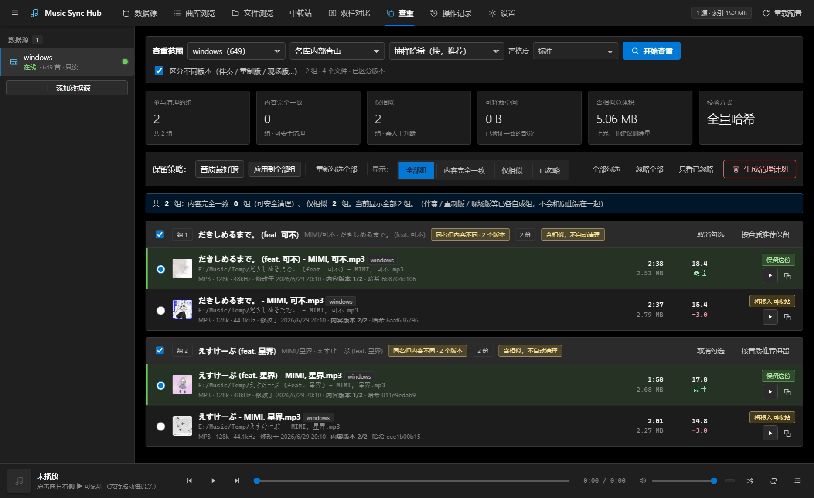

# Music Sync Hub

<div align="center">

**A cross-platform music library management tool for syncing and deduplicating music collections**

[](LICENSE)
[](https://www.python.org/downloads/)
[](tests/)

[Features](#features) • [Quick Start](#quick-start) • [Documentation](#documentation) • [Screenshots](#screenshots) • [Contributing](#contributing)

English | [简体中文](README.zh-CN.md)

</div>

---

## Overview

Music Sync Hub is a music library management tool designed for users managing multiple music collections across different servers or devices. It provides a **side-by-side comparison** interface to identify differences, duplicates, and missing files between libraries, without requiring identical metadata.

**Key Highlights:**
- 🔍 **Smart Matching** — Identifies identical songs even with different filenames or metadata
- 🔄 **Safe Syncing** — Copy, move, or rename with preview-before-execute workflow
- 🗑️ **Trash Recovery** — All deletions go to a recoverable trash directory
- 🎵 **Built-in Player** — Preview audio files directly in the browser
- 📊 **Quality Analysis** — Automatic audio quality scoring and format comparison
- 🌐 **Multiple Sources** — Local, SFTP, WebDAV, SMB, FTP support

---

## Features

### Core Functionality

- **Dual-Pane Comparison** — Side-by-side view of two music libraries with matching status indicators
- **Intelligent Matching** — Multi-factor algorithm using filename, duration, tags, and content hash
- **Duplicate Detection** — Find byte-identical copies and different-quality versions across libraries
- **Safe File Operations** — Preview all changes before execution; deletions go to trash, not permanent removal
- **Resumable Transfers** — Large file transfers can be resumed after interruption with verification
- **Audio Streaming** — Play any track in the browser via HTTP range requests
- **Metadata Editing** — Read and write ID3/Vorbis/MP4 tags with backup support
- **Quality Scoring** — Automatic audio quality assessment based on format, bitrate, sample rate

### Data Source Support

| Type | Status | Description |
|------|--------|-------------|
| **Local/Mapped Drives** | ✅ Stable | Windows/Linux/macOS local filesystems |
| **SFTP** | ⚠️ Experimental | SSH File Transfer Protocol |
| **WebDAV** | ⚠️ Experimental | Web-based file access |
| **SMB** | ⚠️ Experimental | Windows network shares |
| **FTP/FTPS** | ⚠️ Experimental | File Transfer Protocol |

> **Note:** Network adapters are functional but not extensively tested in production. Use with caution.

### Safety Guarantees

1. **No Automatic Overwrites** — Existing files are never replaced without explicit confirmation
2. **Recoverable Deletion** — Files move to `<library>/.music-sync-trash/YYYYMMDD/` with original path tracking
3. **Verified Transfers** — Cross-library moves use copy→verify→delete workflow; source is preserved if verification fails

---

## Quick Start

### Requirements

- Python 3.11 or higher
- [uv](https://docs.astral.sh/uv/) (recommended) or pip

### Installation

**Using uv (recommended):**

```bash
# Install uv if not already installed
curl -LsSf https://astral.sh/uv/install.sh | sh  # macOS/Linux
# or
powershell -c "irm https://astral.sh/uv/install.ps1 | iex"  # Windows

# Clone the repository
git clone https://github.com/yourusername/MusicSyncHub.git
cd MusicSyncHub

# Install dependencies
uv sync
```

**Using pip:**

```bash
pip install -e .
```

### Running the Application

**Quick start with demo library:**

```bash
python run-test.py
```

This starts a test instance with sample audio files (no real data touched). Open <http://127.0.0.1:8787> in your browser.

**Production mode:**

```bash
# Linux/macOS
./start.sh

# Windows
start.bat

# Custom host/port
./start.sh 0.0.0.0 9000
```

### Basic Usage

1. **Add Data Sources** — Click "➕ Add Source" and configure your music libraries
2. **Scan Libraries** — Click "🔄 Scan" on each source to build the index
3. **Compare** — Select two sources and click "Start Comparison" to see differences
4. **Generate Plan** — Choose sync direction (left→right, right→left, or bidirectional)
5. **Preview & Execute** — Review the plan, then execute selected operations

See [QUICKSTART.md](QUICKSTART.md) for a detailed walkthrough.

---

## Documentation

### For Users

| Document | Description |
|----------|-------------|
| [QUICKSTART.md](QUICKSTART.md) | 5-minute getting started guide |
| [User Guide](docs/USER_GUIDE.md) | Complete manual covering every feature and setting |
| [Feature Tree](docs/FEATURE_TREE.md) | Hierarchical feature map with API endpoints |
| [FAQ & Troubleshooting](docs/USER_GUIDE.md#faq) | Common issues and solutions |

### For Developers

| Document | Description |
|----------|-------------|
| [AGENTS.md](AGENTS.md) | **Read this first** — 13 critical constraints and code map |
| [Technical Documentation](docs/TECHNICAL.md) | Architecture, data model, algorithms, API reference |
| [Logic Tree](docs/LOGIC_TREE.md) | Write operation flow, state management, invariants |
| [SAFETY.md](SAFETY.md) | Real incident postmortems and safety rules |
| [Testing Guide](docs/TESTING.md) | Test suite overview and how to add tests |
| [CONTRIBUTING.md](CONTRIBUTING.md) | Development setup and contribution guidelines |
| [Known Issues](docs/KNOWN_ISSUES.md) | Tracked bugs and limitations |

---

## Architecture

### Technology Stack

**Backend:**
- **Framework:** FastAPI (async Python web framework)
- **Database:** SQLite with WAL mode
- **Audio:** mutagen (metadata parsing), Pillow (cover thumbnails)
- **Storage:** Local filesystem + network adapters (paramiko, pysmb, webdavclient3)

**Frontend:**
- **No build required:** Vanilla HTML/CSS/JavaScript
- **Design:** Windows 10 Metro/Fluent style
- **Icons:** Inline SVG (no external dependencies)

### Project Structure

```
MusicSyncHub/
├── app/
│   ├── main.py              # FastAPI app and routes
│   ├── deps.py              # Shared runtime state
│   ├── core/                # Core business logic
│   │   ├── config.py        # Settings and secrets
│   │   ├── db.py            # SQLite schema and queries
│   │   ├── scanner.py       # File indexing
│   │   ├── matching.py      # Song matching algorithm
│   │   ├── plan.py          # Sync plan generation
│   │   ├── ops.py           # Safe file operations executor
│   │   └── jobs.py          # Background task management
│   ├── sources/             # Data source adapters
│   │   ├── local.py         # Local filesystem
│   │   ├── sftp.py          # SFTP
│   │   └── ...              # WebDAV, SMB, FTP, HTTP
│   └── web/                 # Frontend assets
│       ├── index.html
│       └── static/
│           ├── css/app.css
│           └── js/          # Modular vanilla JS
├── tests/                   # 723 unit tests
├── tools/                   # Audit and smoke test tools
└── docs/                    # Documentation
```

### Matching Algorithm

The matching algorithm uses a multi-factor evidence chain:

1. **Normalized Filename** (38% weight) — Strips prefixes like "01 -", suffixes like "(320k)"
2. **Duration Proximity** (34% weight) — Must be within 2× tolerance (default 2s)
3. **Tag Similarity** (16% weight) — Title, artist, album fuzzy matching
4. **File Size** (12% weight) — Consistency check
5. **Content Hash** — SHA1 of head/tail samples (full hash for files ≤6MB)

**Anti-False-Match Rules:**
- Duration difference > 2× tolerance → Not matched (live/remix versions)
- Artist mismatch with confidence >0.55 → Veto
- Same name, different content → Grouped as "versions" but never auto-deleted together

---

## Screenshots

### Dual-Pane Comparison


### Duplicate Detection


### Audio Player


> *Note: Add screenshots to `docs/screenshots/` directory*

---

## Configuration

Configuration is stored in `~/.music-sync-hub/config.toml` (or `%USERPROFILE%\.music-sync-hub\config.toml` on Windows).

### Example Configuration

```toml
[[sources]]
id = "local-windows"
name = "Windows Music Library"
type = "local"
root = "D:/Music"
read_only = false

[[sources]]
id = "nas-linux"
name = "NAS Music Archive"
type = "sftp"
root = "/mnt/music"
host = "192.168.1.100"
port = 22
username = "user"
read_only = true

[settings]
scan_workers = 8
hash_size_limit_mb = 512
quick_hash_probe_kb = 256
duration_tolerance_sec = 2.0
name_similarity = 0.86
default_keep_policy = "best_quality"
```

### Environment Variables

| Variable | Description | Default |
|----------|-------------|---------|
| `MSH_DATA_DIR` | Data directory for config/index/logs | `~/.music-sync-hub` |
| `MSH_DB` | SQLite database path | `<DATA_DIR>/index.sqlite3` |
| `MSH_HOST` | Bind address | `127.0.0.1` |
| `MSH_PORT` | Listen port | `8787` |
| `MSH_TEST_MODE` | Enable test mode UI indicators | `0` |

---

## Testing

### Run Tests

```bash
# Unit tests (723 tests)
python -m unittest discover -s tests -t .

# Frontend static checks
python tools/check_frontend.py
python tools/audit_frontend.py

# API smoke tests (90 endpoints)
python -m app.main &  # Start server in background
python tools/smoke_api.py
```

### Test Coverage

- **Unit Tests:** 723 tests covering core algorithms, file operations, and API endpoints
- **Integration Tests:** End-to-end workflows with sample libraries
- **Safety Tests:** Guard tests for each of the 13 critical constraints (see AGENTS.md)

---

## Contributing

Contributions are welcome! Please read [CONTRIBUTING.md](CONTRIBUTING.md) before submitting pull requests.

### Development Setup

```bash
# Clone and install
git clone https://github.com/yourusername/MusicSyncHub.git
cd MusicSyncHub
uv sync

# Run in dev mode with test data
python run-test.py

# Make changes, then verify
python -m unittest discover -s tests -t .
python tools/audit_split.py  # Check for import/routing issues
```

### Critical Guidelines

**Before changing code, read [AGENTS.md](AGENTS.md)** — it documents 13 hard constraints that prevent data loss. Key rules:

1. Never modify files without preview-execute workflow
2. All deletions must go through trash system
3. Cross-library moves must verify before deleting source
4. Audio extensions must come from single source (`app/core/paths.py`)
5. Path coordinates must use relative paths internally

---

## Project Status

⚠️ **Important Notices:**

- **Personal Use Project:** This tool is primarily for personal use and is still under active testing. Behavior and APIs may change.
- **AI-Assisted Development:** Large portions of this codebase were generated with AI assistance (DeepSeek Harness) and reviewed through multiple audit rounds with 723 automated tests. However, **always backup your data** before using any file management tool.
- **No Authentication:** The web UI has no login system. By default it only listens on `127.0.0.1`. **Do not expose directly to the internet** without proper authentication (use SSH tunnels or reverse proxy).
- **Network Adapters:** SFTP, WebDAV, SMB, FTP adapters are marked experimental — they have complete code paths but **have not been extensively tested against real servers**.

---

## Known Issues

See [docs/KNOWN_ISSUES.md](docs/KNOWN_ISSUES.md) for a prioritized list of tracked bugs and limitations.

Top issues:
- Network data sources lack real-world validation
- Large directory listings (>10k files) may be slow
- No transaction fingerprinting between plan generation and execution

---

## License

This project is licensed under the MIT License - see the [LICENSE](LICENSE) file for details.

Third-party dependencies and their licenses are listed in [THIRD_PARTY_NOTICES.md](THIRD_PARTY_NOTICES.md).

---

## Changelog

See [CHANGELOG.md](CHANGELOG.md) for version history and release notes.

---

## Acknowledgments

- **mutagen** — Audio metadata parsing
- **FastAPI** — Modern Python web framework
- **paramiko**, **pysmb**, **webdavclient3** — Network protocol implementations
- All contributors and testers who helped identify edge cases

---

## Contact & Support

- **Issues:** [GitHub Issues](https://github.com/yourusername/MusicSyncHub/issues)
- **Documentation:** [docs/](docs/)
- **Security:** See [SAFETY.md](SAFETY.md) for security-related concerns

---

<div align="center">

**Made with ❤️ for music collectors**

[⬆ Back to Top](#music-sync-hub)

</div>
