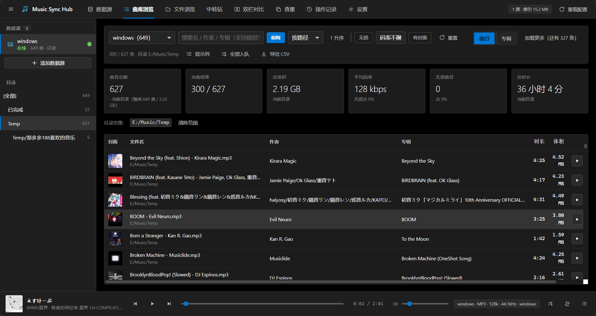
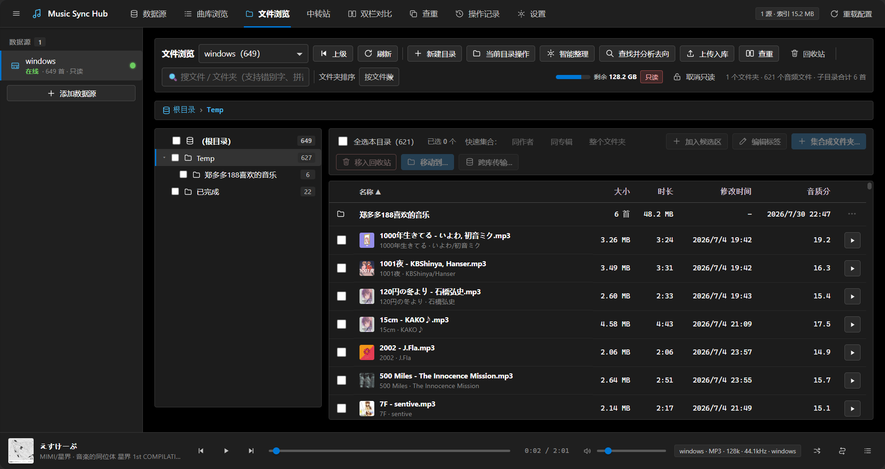

# Music Sync Hub

<div align="center">

**跨平台音乐库管理工具，用于同步和去重音乐收藏**

[](LICENSE)
[](https://www.python.org/downloads/)
[](tests/)

[功能特性](#功能特性) • [快速开始](#快速开始) • [文档](#文档) • [截图](#截图) • [参与贡献](#参与贡献)

[English](README.md) | 简体中文

</div>

---

## 项目概述

Music Sync Hub 是一个音乐库管理工具，专为管理跨多台服务器或设备的音乐收藏而设计。它提供**双栏对比**界面，用于识别库之间的差异、重复和缺失文件，无需元数据完全一致。

**核心亮点：**
- 🔍 **智能匹配** — 即使文件名或元数据不同也能识别相同歌曲
- 🔄 **安全同步** — 复制、移动或重命名均采用预览后执行工作流
- 🗑️ **回收站恢复** — 所有删除操作都可恢复
- 🎵 **内置播放器** — 在浏览器中直接预览音频文件
- 📊 **音质分析** — 自动音质评分和格式对比
- 🌐 **多种数据源** — 支持本地、SFTP、WebDAV、SMB、FTP

---

## 功能特性

### 核心功能

- **双栏对比** — 并排查看两个音乐库，显示匹配状态指示器
- **智能匹配** — 使用文件名、时长、标签和内容哈希的多因子算法
- **重复检测** — 查找字节完全相同的副本和不同音质版本
- **安全文件操作** — 执行前预览所有更改；删除操作进入回收站而非永久删除
- **断点续传** — 大文件传输中断后可恢复，带校验
- **音频流媒体** — 通过 HTTP 范围请求在浏览器中播放任何曲目
- **元数据编辑** — 读写 ID3/Vorbis/MP4 标签，支持备份
- **音质评分** — 基于格式、码率、采样率自动评估音质

### 数据源支持

| 类型 | 状态 | 说明 |
|------|------|------|
| **本地/映射盘符** | ✅ 稳定 | Windows/Linux/macOS 本地文件系统 |
| **SFTP** | ⚠️ 实验性 | SSH 文件传输协议 |
| **WebDAV** | ⚠️ 实验性 | 基于 Web 的文件访问 |
| **SMB** | ⚠️ 实验性 | Windows 网络共享 |
| **FTP/FTPS** | ⚠️ 实验性 | 文件传输协议 |

> **注意：** 网络适配器功能完整但未经过生产环境广泛测试，请谨慎使用。

### 安全保证

1. **不自动覆盖** — 未经明确确认，现有文件永远不会被替换
2. **可恢复删除** — 文件移动到 `<库根>/.music-sync-trash/YYYYMMDD/` 并记录原始路径
3. **校验传输** — 跨库移动使用"复制→校验→删除"工作流；校验失败时保留源文件

---

## 快速开始

### 系统要求

- Python 3.11 或更高版本
- [uv](https://docs.astral.sh/uv/)（推荐）或 pip

### 安装

**使用 uv（推荐）：**

```bash
# 如果尚未安装 uv
curl -LsSf https://astral.sh/uv/install.sh | sh  # macOS/Linux
# 或
powershell -c "irm https://astral.sh/uv/install.ps1 | iex"  # Windows

# 克隆仓库
git clone https://github.com/WisteriaZy/MusicSyncHub.git
cd MusicSyncHub

# 安装依赖
uv sync
```

**使用 pip：**

```bash
pip install -e .
```

### 运行应用

**使用演示库快速开始：**

```bash
python run-test.py
```

这会启动一个包含示例音频文件的测试实例（不触碰真实数据）。在浏览器中打开 <http://127.0.0.1:8787>。

**生产模式：**

```bash
# Linux/macOS
./start.sh

# Windows
start.bat

# 自定义主机/端口
./start.sh 0.0.0.0 9000
```

### 基础用法

1. **添加数据源** — 点击"➕ 添加数据源"并配置你的音乐库
2. **扫描库** — 在每个数据源上点击"🔄 扫描"以建立索引
3. **对比** — 选择两个数据源，点击"开始对比"查看差异
4. **生成方案** — 选择同步方向（左→右、右→左或双向）
5. **预览并执行** — 查看方案，然后执行选定的操作

详细步骤请参阅 [QUICKSTART.md](QUICKSTART.md)。

---

## 文档

### 用户文档

| 文档 | 说明 |
|------|------|
| [QUICKSTART.md](QUICKSTART.md) | 5 分钟入门指南 |
| [用户指南](docs/USER_GUIDE.md) | 涵盖所有功能和设置的完整手册 |
| [功能树](docs/FEATURE_TREE.md) | 层级功能图谱及 API 端点 |
| [常见问题](docs/USER_GUIDE.md#faq) | 常见问题和解决方案 |

### 开发者文档

| 文档 | 说明 |
|------|------|
| [AGENTS.md](AGENTS.md) | **必读** — 13 条关键约束和代码地图 |
| [技术文档](docs/TECHNICAL.md) | 架构、数据模型、算法、API 参考 |
| [逻辑树](docs/LOGIC_TREE.md) | 写操作流程、状态管理、不变量 |
| [SAFETY.md](SAFETY.md) | 真实事故复盘和安全规则 |
| [测试指南](docs/TESTING.md) | 测试套件概览和添加测试的方法 |
| [CONTRIBUTING.md](CONTRIBUTING.md) | 开发环境设置和贡献指南 |
| [已知问题](docs/KNOWN_ISSUES.md) | 已跟踪的 bug 和限制 |

---

## 架构

### 技术栈

**后端：**
- **框架：** FastAPI（异步 Python Web 框架）
- **数据库：** SQLite with WAL 模式
- **音频：** mutagen（元数据解析）、Pillow（封面缩略图）
- **存储：** 本地文件系统 + 网络适配器（paramiko、pysmb、webdavclient3）

**前端：**
- **无需构建：** 原生 HTML/CSS/JavaScript
- **设计风格：** Windows 10 Metro/Fluent 风格
- **图标：** 内联 SVG（无外部依赖）

### 项目结构

```
MusicSyncHub/
├── app/
│   ├── main.py              # FastAPI 应用和路由
│   ├── deps.py              # 共享运行时状态
│   ├── core/                # 核心业务逻辑
│   │   ├── config.py        # 设置和密钥
│   │   ├── db.py            # SQLite 模式和查询
│   │   ├── scanner.py       # 文件索引
│   │   ├── matching.py      # 歌曲匹配算法
│   │   ├── plan.py          # 同步方案生成
│   │   ├── ops.py           # 安全文件操作执行器
│   │   └── jobs.py          # 后台任务管理
│   ├── sources/             # 数据源适配器
│   │   ├── local.py         # 本地文件系统
│   │   ├── sftp.py          # SFTP
│   │   └── ...              # WebDAV、SMB、FTP、HTTP
│   └── web/                 # 前端资源
│       ├── index.html
│       └── static/
│           ├── css/app.css
│           └── js/          # 模块化原生 JS
├── tests/                   # 723 个单元测试
├── tools/                   # 审计和冒烟测试工具
└── docs/                    # 文档
```

### 匹配算法

匹配算法使用多因子证据链：

1. **归一化文件名**（38% 权重）— 去除"01 -"等前缀、"(320k)"等后缀
2. **时长接近度**（34% 权重）— 必须在 2 倍容差内（默认 2 秒）
3. **标签相似度**（16% 权重）— 标题、艺术家、专辑模糊匹配
4. **文件大小**（12% 权重）— 一致性检查
5. **内容哈希** — 头尾采样的 SHA1（≤6MB 文件使用全量哈希）

**防误判规则：**
- 时长差 > 2× 容差 → 不匹配（现场版/混音版）
- 艺术家不匹配且置信度 >0.55 → 否决
- 同名但内容不同 → 归为"版本"分组但永不自动一起删除

---

## 截图

### 重复检测


*智能匹配识别跨库相同歌曲,按内容哈希和音质分组*

### 曲库浏览


*浏览已索引的音乐收藏,显示元数据、音质评分和内联播放器*

### 文件操作


*预览后执行工作流的安全文件操作,带暂存区*

---

## 配置

配置文件存储在 `~/.music-sync-hub/config.toml`（Windows 上为 `%USERPROFILE%\.music-sync-hub\config.toml`）。

### 配置示例

```toml
[[sources]]
id = "local-windows"
name = "Windows 音乐库"
type = "local"
root = "D:/Music"
read_only = false

[[sources]]
id = "nas-linux"
name = "NAS 音乐归档"
type = "sftp"
root = "/mnt/music"
host = "192.168.1.100"
port = 22
username = "user"
read_only = true

[settings]
scan_workers = 8
hash_size_limit_mb = 512
quick_hash_probe_kb = 256
duration_tolerance_sec = 2.0
name_similarity = 0.86
default_keep_policy = "best_quality"
```

### 环境变量

| 变量 | 说明 | 默认值 |
|------|------|--------|
| `MSH_DATA_DIR` | 配置/索引/日志的数据目录 | `~/.music-sync-hub` |
| `MSH_DB` | SQLite 数据库路径 | `<DATA_DIR>/index.sqlite3` |
| `MSH_HOST` | 绑定地址 | `127.0.0.1` |
| `MSH_PORT` | 监听端口 | `8787` |
| `MSH_TEST_MODE` | 启用测试模式 UI 指示器 | `0` |

---

## 测试

### 运行测试

```bash
# 单元测试（723 个测试）
python -m unittest discover -s tests -t .

# 前端静态检查
python tools/check_frontend.py
python tools/audit_frontend.py

# API 冒烟测试（90 个端点）
python -m app.main &  # 后台启动服务器
python tools/smoke_api.py
```

### 测试覆盖

- **单元测试：** 723 个测试覆盖核心算法、文件操作和 API 端点
- **集成测试：** 使用示例库的端到端工作流
- **安全测试：** 13 条关键约束的守护测试（见 AGENTS.md）

---

## 参与贡献

欢迎贡献！提交 Pull Request 前请阅读 [CONTRIBUTING.md](CONTRIBUTING.md)。

### 开发环境设置

```bash
# 克隆并安装
git clone https://github.com/WisteriaZy/MusicSyncHub.git
cd MusicSyncHub
uv sync

# 使用测试数据运行开发模式
python run-test.py

# 更改后验证
python -m unittest discover -s tests -t .
python tools/audit_split.py  # 检查导入/路由问题
```

### 关键准则

**更改代码前请阅读 [AGENTS.md](AGENTS.md)** — 它记录了防止数据丢失的 13 条硬约束。关键规则：

1. 未经预览-执行工作流不得修改文件
2. 所有删除必须通过回收站系统
3. 跨库移动必须在删除源文件前校验
4. 音频扩展名必须来自单一源（`app/core/paths.py`）
5. 路径坐标内部必须使用相对路径

---

## 项目状态

⚠️ **重要声明：**

- **个人使用项目：** 此工具主要用于个人使用，仍在积极测试中。行为和 API 可能会更改。
- **AI 辅助开发：** 此代码库的大部分内容由 AI（DeepSeek Harness）辅助生成，并通过多轮审计和 723 个自动化测试进行审查。但是，**请始终备份数据**再使用任何文件管理工具。
- **无身份验证：** Web UI 没有登录系统。默认仅监听 `127.0.0.1`。**请勿直接暴露到互联网**（请使用 SSH 隧道或反向代理加认证）。
- **网络适配器：** SFTP、WebDAV、SMB、FTP 适配器标记为实验性 — 它们有完整的代码路径，但**未经过真实服务器的广泛测试**。

---

## 已知问题

请参阅 [docs/KNOWN_ISSUES.md](docs/KNOWN_ISSUES.md) 了解按优先级排序的已跟踪 bug 和限制清单。

主要问题：
- 网络数据源缺乏真实世界验证
- 大型目录列表（>10k 文件）可能较慢
- 方案生成和执行之间没有事务指纹

---

## 许可证

本项目采用 MIT 许可证 - 详见 [LICENSE](LICENSE) 文件。

第三方依赖及其许可证列在 [THIRD_PARTY_NOTICES.md](THIRD_PARTY_NOTICES.md) 中。

---

## 变更日志

版本历史和发布说明见 [CHANGELOG.md](CHANGELOG.md)。

---

## 致谢

- **mutagen** — 音频元数据解析
- **FastAPI** — 现代 Python Web 框架
- **paramiko**、**pysmb**、**webdavclient3** — 网络协议实现
- 所有帮助识别边缘情况的贡献者和测试人员

---

## 联系与支持

- **问题反馈：** [GitHub Issues](https://github.com/WisteriaZy/MusicSyncHub/issues)
- **文档：** [docs/](docs/)
- **安全问题：** 见 [SAFETY.md](SAFETY.md) 了解安全相关事宜

---

<div align="center">

**用 ❤️ 为音乐收藏者打造**

[⬆ 返回顶部](#music-sync-hub)

</div>
