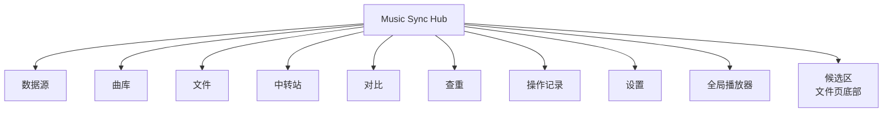

# 功能关系树

> 把"这个软件到底能做什么"按**页面 → 功能 → 动作**三级列清楚，
> 每个动作标注它对应的接口。接手的人可以从这里判断"要改的东西在哪一层"。
>
> 相关文档：[逻辑关系树](LOGIC_TREE.md)（内部怎么运转）、
> [用户指南](USER_GUIDE.md)（怎么用）、[技术说明](TECHNICAL.md)（细节实现）。

---

## 0. 一句话总览

一个**本地运行**的 Web 应用：把两台机器（或两个盘、两台 NAS）上的音乐库
放在一起对比，找出"你有我没有""重复但不一样""放错位置"，
然后用**永不覆盖、可回滚**的方式搬运和整理。

```
浏览器（纯静态 HTML/JS，无构建）
        │  fetch /api/...
        ▼
FastAPI（单进程 uvicorn）
        │
        ├── 索引库 index.sqlite3   （曲目元数据 / 任务 / 封面）
        ├── config.toml            （数据源 + 设置，可手改）
        └── 数据源适配器           （本地盘 / 网络盘 / SFTP / WebDAV / HTTP / SMB / FTP）
```

---

## 1. 功能树（页面维度）



### 1.1 数据源（`views.sources.js`）

| 功能 | 动作 | 接口 |
| --- | --- | --- |
| 查看数据源 | 列表 / 索引条数 / 只读标记 / 可用性 | `GET /api/sources`、`GET /api/sources/status` |
| 新建 | 选类型 → 填根目录 → 可选密码 | `POST /api/sources` |
| 修改 | 改名 / 改根 / 改只读 / 改连接参数 | `PUT /api/sources/{sid}` |
| 删除 | 移除配置（索引记录同时清理；**不删文件**） | `DELETE /api/sources/{sid}` |
| 扫描 | 建立/刷新索引（可算哈希） | `POST /api/scan/{sid}` |
| 测试连接 | 远端源连通性 | `POST /api/sources/{sid}/test` |
| 浏览目录 | 配置根目录时点选 | `POST /api/sources/{sid}/browse` |
| 盘符 / 设备 | 列出可用盘、U 盘、网络位置、速度判断 | `GET /api/drives`、`GET /api/device/probe` |

**支持的类型**：`local`（本地盘/映射盘）、`sftp`、`webdav`、`http`、`smb`、`ftp`。
后五种标 `experimental`，未在真实服务器上验证过 —— 这是**已知限制**，不是 bug。

### 1.2 曲库（`views.library.js`）

| 功能 | 动作 | 接口 |
| --- | --- | --- |
| 浏览 | 分页表格 / 按专辑分组（封面墙） | `GET /api/library/{sid}` |
| 搜索 | 模糊搜索（标题/作者/文件名，带打分） | 同上（`q`） |
| 筛选 | 无损 / 码率下限 / 有封面 / 目录范围 | 同上 |
| 排序 | 路径/文件名/标题/作者/专辑/时长/码率/体积/音质/修改时间 | 同上（`sort`/`order`） |
| 列显示 | 自选列并记住 | 前端偏好 |
| 导出 | 当前结果导出 CSV | 前端生成 |
| 单曲操作 | 播放 / 加入播放列表 / 详情 | `GET /api/track/{tid}` |
| 详情 | 元数据、封面、试听、刷新单曲 | `GET /api/track/{tid}`、`POST /api/track/{tid}/refresh` |
| 批量刷新 | 重读一批曲目的元数据 | `POST /api/track/refresh` |

### 1.3 文件（`views.files.js`）—— 最重的一页

左侧目录树 + 右侧文件表 + 底部候选区。

| 功能 | 动作 | 接口 |
| --- | --- | --- |
| 目录树 | 展开/折叠、曲目数、勾选整棵子树 | `GET /api/files/folders` |
| 文件列表 | 当前目录的子目录 + 音频文件（带索引元数据） | `GET /api/files/list` |
| 面包屑 | 点任意层级跳转 | 同上 |
| 目录搜索 | 按名字跳目录 | `GET /api/files/search` |
| 维度统计 | 按作者/专辑/编码/格式分布 | `GET /api/files/facets` |
| 子树文件 | 勾选多个目录 → 列出全部音频 | `POST /api/files/under` |
| 选择解析 | 把勾选（文件/目录/子树）展开成文件清单 | `POST /api/files/select` |
| 存在性检查 | 批量问"这些还在不在" | `POST /api/files/exists` |
| 单曲播放 | 试听这一首 | `GET /api/preview/{tid}` |
| **加入播放列表** | 行尾 `＋` 按钮，追加到队列末尾 | 前端队列 |
| 移动 | 同源移动（预演 → 执行，带冲突策略） | `POST /api/files/move` |
| 跨库传输 | 复制 → 校验 → 删源；支持标准/快速模式；**中断后可断点续传** | `POST /api/files/transfer` |
| 编辑标签 | 批量改标题/作者/专辑/封面（先备份） | `POST /api/tags/write` |
| 撤销标签 | 从标签备份还原 | `POST /api/tags/restore`、`GET /api/tags/backups` |
| 新建/改名/删除目录 | 目录级操作 | `POST /api/folders/*` |
| 智能整理 | 单曲归位 / 按专辑整理（**先出方案再执行**） | `POST /api/organize/*` |
| 收集 | 把散落的歌收进一个目录 | `POST /api/collect/preview`、`/apply` |
| **候选区** | 跨目录凑清单 → 统一分配去向 → 执行移动 | 见 1.9 |
| **回收站** | 列出已删除项（含原位置）→ 还原回原位 / 彻底删除 | `GET /api/trash`、`POST /api/trash/restore`、`POST /api/trash/purge` |

### 1.4 中转站（`views.station.js`）

"这首我还没想好放哪"的缓冲区。文件从中转站进出都走**移动**（不复制、不删除）。

| 功能 | 动作 | 接口 |
| --- | --- | --- |
| 查看 | 中转站里的文件、占用、容量上限 | `GET /api/station` |
| 容量检查 | 是否超过 `station_max_gb` | `GET /api/station/check` |
| 移入 | 从库里移进中转站 | `POST /api/station/move-in` |
| 归位 | 从中转站移回指定目录 | `POST /api/station/move-out` |
| 建议去向 | 按规则推荐目录 | `POST /api/station/suggest` |
| 删除 | 移入数据源回收站（可恢复） | `POST /api/station/remove` |
| 还原 | 从中转站回收站还原（需二次确认） | `POST /api/station/restore` |

### 1.5 对比（`views.compare.js`）

| 功能 | 动作 | 接口 |
| --- | --- | --- |
| 选两侧 | 左/右数据源、方向 | — |
| 对比 | 匹配算法找出对应曲目 | `POST /api/compare` |
| 看差异 | 仅左侧 / 仅右侧 / 配对 / 可疑 | 同上（返回分组） |
| 试听对比 | 两边各播一段 | `GET /api/preview/{tid}` |
| 生成方案 | 复制缺失 / 清理重复 / 生成步骤 | `POST /api/plan` |
| 预演 | 逐步检查（不写盘） | `POST /api/execute`（`execute=false`） |
| 执行 | 带指纹校验、二次确认 | `POST /api/execute`（`execute=true`） |

### 1.6 查重（`views.duplicates.js`）

| 功能 | 动作 | 接口 |
| --- | --- | --- |
| 范围 | 跨库 / 库内 / 指定源 | `POST /api/duplicates` |
| 判据 | 内容哈希（快速/完整/无）、名称相似、时长容差 | 同上 |
| 结果 | 按组展示、版本标签、浪费空间统计 | 同上 |
| 选保留项 | 手工指定 / 按策略建议（最早/最大/最优） | `POST /api/duplicates/keep` |
| 清理 | 生成 `trash` 步骤（进回收站，可恢复） | `POST /api/plan`（`include_duplicates`） |

### 1.7 操作记录（`views.ops.js`）

| 功能 | 动作 | 接口 |
| --- | --- | --- |
| 任务列表 | 进行中 / 已完成 / 出错 | `GET /api/jobs` |
| 进度 | 轮询进度、当前步骤 | `GET /api/jobs/{jid}` |
| 暂停/继续 | 在步骤边界暂停 | `POST /api/jobs/{jid}/pause`、`/resume` |
| 取消 | 已完成的保留、未完成的停 | `POST /api/jobs/{jid}/cancel` |
| 确认 | 清掉"已完成"提示 | `POST /api/jobs/{jid}/ack` |
| 忽略 | 从记录里**删掉**（运行中的不允许） | `POST /api/jobs/{jid}/dismiss` |
| 批量清理 | 一次清掉所有已结束任务 | `POST /api/jobs/clear-finished` |
| 恢复 | 崩溃后"接着做完"（需二次确认） | `GET /api/unfinished`、`POST /api/unfinished/recover` |
| 独占状态 | 当前是否有写任务 | `GET /api/busy` |

### 1.8 设置（`views.settings.js`）

| 功能 | 动作 | 接口 |
| --- | --- | --- |
| 读设置 | 16 个字段 | `GET /api/settings` |
| 写设置 | 逐字段校验（非法值 400） | `PUT /api/settings` |
| 重载配置 | 手改 `config.toml` 后生效 | `POST /api/reload` |
| 后台日志 | 内存最近若干条 / 完整日志文件 | `GET /api/logs`、`POST /api/logs/clear` |
| 系统信息 | 版本、扩展名、版本标签、测试模式 | `GET /api/system` |
| 界面偏好 | 主题、列显示、播放器模式（存浏览器） | 前端偏好 |

### 1.9 候选区（文件页底部，`staging.js`）

跨目录凑一批文件，统一决定去哪。

| 功能 | 动作 | 接口 |
| --- | --- | --- |
| 加入 | 勾选文件/目录 → 加入候选区（只收音频） | 前端（localStorage 持久化） |
| 手动设去向 | 目录选择器选一个目录 | `POST /api/sources/{sid}/browse` |
| **智能分配去向** | 先选规则（分组依据/结构/最少同组）→ **预览** → 采用 | `POST /api/organize/plan-paths` |
| 执行 | 按去向分列执行移动 | `POST /api/files/move` |
| 检查过期 | 文件是否还在盘上 | `POST /api/files/exists` |
| 颜色分组 | 同一去向同色 | 前端 |

### 1.10 回收站（文件页工具条的「回收站」按钮）

删除的文件/目录进 `<库根>/.music-sync-trash/<日期>/`（或设置里指定的 `trash_dir`）。

| 功能 | 行为 | 接口 |
| --- | --- | --- |
| 查看 | 按时间倒序列出，显示**原位置**、大小、删除时间 | `GET /api/trash` |
| 还原 | 默认回到原目录；同名跳过/改名，绝不覆盖 | `POST /api/trash/restore` |
| 彻底删除 | 需 `confirm`，界面上还要输入短语 | `POST /api/trash/purge` |

原路径记在回收站目录里的 `_origin.json`：跟着回收站走，索引库重建也不丢。
**只支持本地/映射盘数据源**（网络源的删除语义由各适配器决定）。

### 1.11 全局播放器（`app.js` 的 `queue`）

| 功能 | 行为 |
| --- | --- |
| 播放一首 | **只播这一首**（队列 = 1 首） |
| 加入播放列表 | 行尾 `＋` / 专辑的 `＋`：追加到队列末尾，不打断播放 |
| 全部入队 | 曲库工具栏：把当前列表整体入队 |
| 上一首/下一首 | 队列内移动，跳过失效条目 |
| 队列弹窗 | 查看/点选/清空 |
| 双击行 | 等同"播放这一首" |

---

### 1.12 索引自动刷新（后台，`app/core/indexwatch.py`）

| 功能 | 行为 | 配置 |
| --- | --- | --- |
| 目录探测 | 只 stat 已有曲目所在目录的 mtime，变了就只重扫那个子目录 | `auto_index_refresh_seconds`（默认 300，0=关闭） |
| 文件指纹 | 比对 `(size, mtime)`，内容被替换也能发现 | 同上 |
| 陈旧兜底 | `last_scan` 超过 N 小时整源扫一次（兜住"新目录里的新文件"） | `auto_full_rescan_hours`（默认 24，0=不兜底） |
| 并发保护 | 巡检期间持独占 Job；拿不到就让路，绝不和前台写操作并行 | — |

> 只对**本地/映射盘**源生效（网络源 stat 太贵，交给手动扫描）。

## 2. 能力清单（按用户目标）

| 你想做的事 | 该用什么 |
| --- | --- |
| 两台机器上的歌**并成一份** | 对比 → 生成方案 → 预演 → 执行（先复制校验再删源） |
| 找出**重复但格式不同**的歌 | 查重（名称相似 + 时长容差 + 可选哈希） |
| 找出**同一首歌的多份**并只留一份 | 查重 → 选保留项 → 清理（进回收站） |
| 把**放错位置**的歌归位 | 文件 → 智能整理（先看方案） |
| 把**散落的歌**收进一个目录 | 文件 → 收集 |
| **跨目录挑一批**再统一放 | 候选区 → 手动设去向 / 智能分配 |
| 先**腾个地方**，回头再决定 | 中转站 |
| 批量**改标签/封面** | 文件 → 编辑标签（自动备份，可撤销） |
| 看**两边差多少**、哪些没对上 | 对比页的统计与差异列表 |
| 知道**后台在干什么** | 操作记录（进度/暂停/取消/恢复） |

---

## 3. 明确**不做**的事

| 不做 | 原因 |
| --- | --- |
| 删除用户文件而不留副本 | 所有删除默认进 `<root>/.music-sync-trash/YYYYMMDD/`；永久删除必须显式 `hard_delete` 且先校验 |
| 覆盖同名文件 | 默认 `skip`；`overwrite` 会**先把原件移进回收站**再写 |
| 联网、上传、遥测 | 纯本地；只有你自己配的数据源会被访问 |
| 修改音频内容 | 只改标签（有备份）和位置 |
| 自动同步 / 后台常驻 | 所有写操作都要你点；没有定时任务 |

---

## 4. 已知限制

见 [`KNOWN_ISSUES.md`](KNOWN_ISSUES.md)。摘要：

- 网络源（SFTP/WebDAV/HTTP/SMB/FTP）**未在真实服务器上验证**
- 跨进程互斥是"后来者被拒"，不是排队
- `inside_root_real` 每次多一次 realpath（大目录批量略慢）
- `Executor.run` 遇 `BaseException` 靠 180 s 陈旧回收兜底
