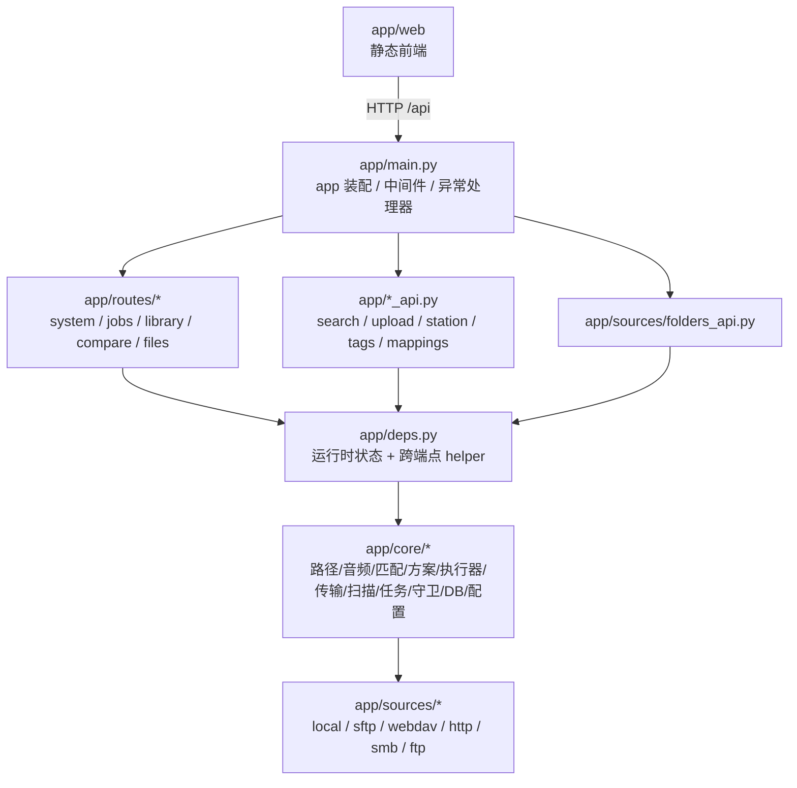
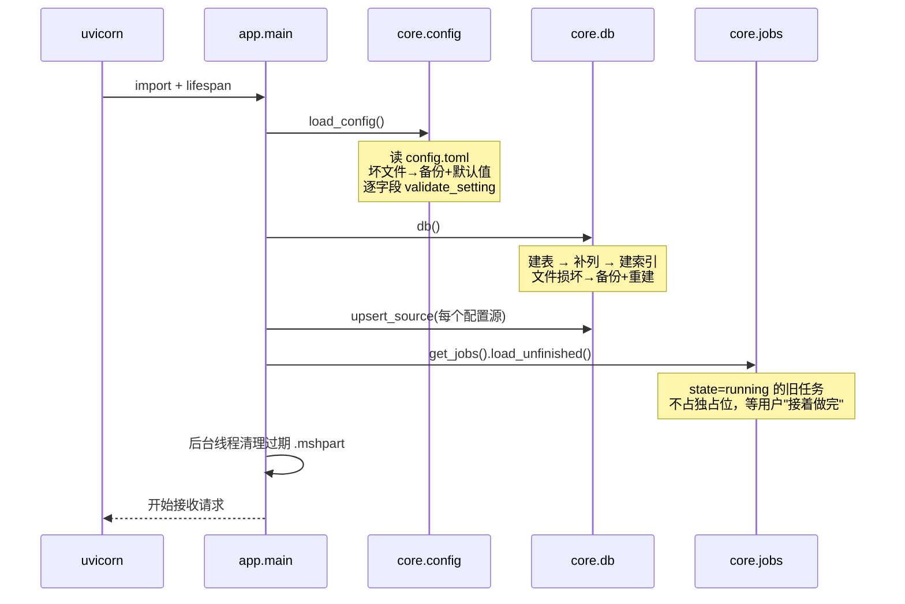
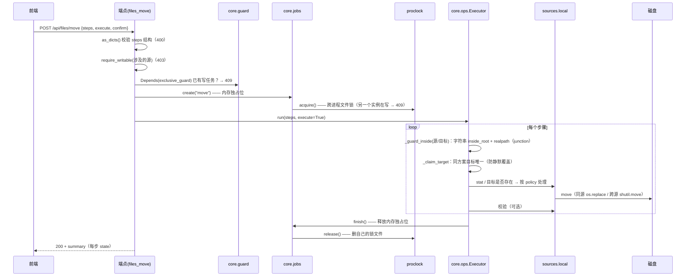

# 逻辑关系树

> 这个软件**内部**怎么运转：谁调用谁、一次写操作为什么不会丢文件、
> 状态存在哪里、出错时走哪条路。
>
> 对外功能见 [功能关系树](FEATURE_TREE.md)；实现细节见 [技术说明](TECHNICAL.md)。

---

## 1. 分层与依赖方向



**硬规则**：

- `core/*` **不许** import `fastapi`、`app.main`、`routes/*`
- `routes/*` 与 `*_api.py` **只依赖** `core/*`、`sources/*`、`deps`
- `main.py` 在**文件最底部**才 import 各 router（避免循环导入）
- 路由模块里的**延迟导入也要写双点**（`from ..core import X`）

违反其中任何一条，`tools/audit_split.py` 与 `test_docstring_index.py` 会报。

---

## 2. 启动链路



**关键点**：启动**不会**因为配置坏、索引库坏、上次崩溃而拒绝服务 ——
只会降级并把原因记下来（`/api/system` 的 `settings_errors`）。

---

## 3. 一次写操作的完整链路

以"移动文件"为例。**每一步都是一道闸门**，任何一道不放行就不会动文件。



### 3.1 「目标已存在」的决策树

```
目标存在？
├── policy=skip      → state=conflict（源**不动**）         ← 默认
├── policy=rename    → 自动改名 "x (2).mp3" 再写
└── policy=overwrite → 先把**原件移进回收站**（可恢复），再写新的
```

`overwrite` 的回收站备份是**必需**的：否则复制中断或校验失败时，
原件和副本会一起消失（这是修过的真实 bug）。

### 3.2 跨库传输（transfer_one）

顺序被**固化**成不可分割的一步，不允许调用方自己拼"先拷后删"：

```
stat 源 → inside_root(源/目标) → 目标存在按 policy
   → copy_from（写 .mshpart → 校验前不改名）
   → verify（大小必有；哈希可选）
        ├── 通过 → 删源（默认进回收站；hard_delete 才永久删）
        └── 失败 → 坏副本改名 .bad-<ts>；**源不删**；返回 error
```

**中断了怎么办**：复制过程中写的是 `<目标>.mshpart`，旁边还有一份
`<目标>.mshpart.json` 记录 `{源 id, 源路径, 源大小}`。下次对**同一个源文件**再传时，
三者全等才从已完成的字节继续写（否则从头来，避免把别的文件的半截接上来）。
续传完成后再比一次总大小；不一致就丢弃临时文件。结果里会带
`resumed_from`，界面上显示"断点续传：从 N 字节处继续"。

**两条硬约束**（都有测试盯着）：

1. **没校验过就不许删源**。`fast` 模式 + `hard_delete` 会被直接拒绝。
2. **校验失败不删用户的原目标**。覆盖前原件已进回收站，可还原。

### 3.3 删除 / 回收站

```
remove(path, hard=False)   → <root>/.music-sync-trash/YYYYMMDD/<name>[ (n)]
remove(path, hard=True)    → 永久删除（仅 op=delete / 显式 hard_delete）
```

回收站文件名冲突时在**锁内循环**找空位（同一秒删 6 个同名文件不会互相覆盖）。

---

## 4. 只读链路（读索引，不碰磁盘）

```
GET /api/library/{sid}
   → deps.db()  → SQL（source_id + 过滤 + 排序 + 分页）
   → _track_view() 归一化（补 name/title/quality 等派生字段）
   → 前端渲染

GET /api/files/list?path=...
   → in_source_rel()（边界：绝对路径必须在根内、禁止 ..、realpath 防 junction）
   → src.listdir()（跳过 reparse point / 非音频）
   → 与索引 join（补元数据）
   → 目录聚合走 _FILE_BROWSE_CACHE（TTL 20s，返回副本）
```

**只读接口一律不占独占位**，但"预演/对比"会在别的写任务进行时返回 409 ——
理由是它读的是**正在变化的状态**，给出的方案不可靠。

---

## 5. 状态存在哪里

| 状态 | 位置 | 生命周期 | 谁负责 |
| --- | --- | --- | --- |
| 曲目索引 | `index.sqlite3`（WAL） | 持久 | `core/db.py` |
| 数据源 + 设置 | `config.toml` | 持久，可手改 | `core/config.py` |
| 任务历史 / 未完成任务 | `job` 表 + 内存注册表 | 内存 + 持久 | `core/jobs.py` |
| 独占位（进程内） | `Jobs._lock` + `_jobs` | 进程内 | `core/jobs.py` |
| 独占位（跨进程） | `<data_dir>/msh-exclusive.lock` | 直到释放/过期 | `core/proclock.py` |
| 目录聚合缓存 | 内存 `_FILE_BROWSE_CACHE` | 20 s | `deps.py` |
| 封面缓存 | 内存 LRU（`cover_cache_size`） | 按需淘汰 | `deps.py` |
| 索引版本号 | `state_meta(rev/del)` | 持久，每次提交 +1 | `core/db.py` |
| 候选区清单 | 浏览器 localStorage | 跨刷新 | `staging.js` |
| 界面偏好 | 浏览器 localStorage | 跨刷新 | `prefs.js` |

`/api/state` 把 `rev` 暴露给前端：前端每几秒问一次，变了才重载 ——
所以另一个标签页做的操作会自动出现。

---

## 6. 三道互斥闸门

| 闸门 | 覆盖范围 | 失效后果 |
| --- | --- | --- |
| 前端 `runExclusive` | 只影响体验（按钮禁用） | 可绕过，不算安全 |
| `Jobs` 内存独占位 | **同进程**所有写流程 | 两个写流程基于过期状态改同一批文件 |
| `proclock` 文件锁 | **跨进程**（两个实例/测试包） | 两边都报 done，目标只剩一份 |

三者的关系是**纵深**，不是重复：客户端的"禁用按钮"永远不能当约束用。

---

## 7. 错误处理与状态码约定

| 情况 | 状态码 | 说明 |
| --- | --- | --- |
| 参数缺失/类型不对 | 400 | `as_list` / `as_text` / `as_dicts` 统一抛 |
| 路径越界 / 经过 junction | 400 | `in_source_rel` / `_guard_inside` |
| 只读源写操作 | 403 | `require_writable`（端点层，不是逐步骤） |
| 数据源/曲目不存在 | 404 | 全局处理器把 `SourceNotFound`/`KeyError` 转 404 |
| 已有写任务 / 跨进程占用 | 409 | `JobBusy` / `LockBusy` 全局处理器 |
| DB 被锁 / 写盘失败 | 503 / 500 | 尽量回滚，不留半截状态 |
| 未预期异常 | 500 | **堆栈只写日志**，返回一句可照做的提示 |

单步失败**只影响该步**：返回 200 + `results[i].state=error`，
不会让整批中断（用户能看清哪几步失败了）。

---

## 8. 配置与索引库的"坏文件"策略

两者都是**可恢复**的，策略一致：

```
读失败（TOML 语法/编码/类型 / SQLite 损坏）
   → 把坏文件改名 <原文件>.broken-<时间戳>
   → 重建默认配置 / 空索引库
   → 记下原因（settings_errors / 日志 / 控制台）
   → 照常启动
```

区别：索引库**可以重建**（重扫一遍就回来）；`config.toml` 里的数据源
只能靠备份找回 —— 所以坏配置会**保留** `.broken-*` 文件并提示用户。

---

## 9. 前端内部结构

```
index.html
  └─ app.js            全局：State / 路由(tab) / 播放器 queue / 侧栏
       ├─ api.js       所有 HTTP 封装 + U.esc 等工具
       ├─ ui.js        modal / toast / confirmHard / 表格工具
       ├─ prefs.js     界面偏好（localStorage，带版本）
       ├─ views.*.js   8 个页面
       ├─ organize.js  智能整理的方案/预览/执行（文件页与候选区共用）
       ├─ staging.js   候选区（文件页底部）
       ├─ tasksync.js  任务进度轮询与跨页同步
       └─ folderpicker.js / upload.js / tags.js
```

- **无构建**：直接 `<script src>`，改完刷新即可（资源带 `?v=N` 防缓存）
- 每个页面一个 `views.xxx.js`，导出 `{ mount, reload }` 之类的对象
- `State` 是唯一全局状态；页面切换不销毁数据，靠 `reload()` 刷新

---

## 10. 不变量清单（改动前先读）

1. **永不覆盖**：默认 `skip`；`overwrite` 先把原件移进回收站。
2. **删除可恢复**：默认进 `.music-sync-trash/YYYYMMDD/`。
3. **传输顺序**：复制 → 校验 → 删源；未校验不得删源。
4. **路径边界**：绝对路径必须在源根内；`..` 一律拒绝；junction 用 realpath 识破。
5. **只读源**：任何写端点都先 `require_writable`（403），且磁盘零变化。
6. **独占**：同进程 + 跨进程两层；预演不占位但要检查忙。
7. **坏文件可恢复**：配置/索引库损坏都备份后降级，不阻止启动。
8. **失败不留半成品**：`.mshpart` 要么改名成正式文件，要么留作临时文件（可清理）；
   坏副本改名 `.bad-*`，不占正式名。

有测试逐条盯着这些不变量（见 `tests/`，共 823 项）。
